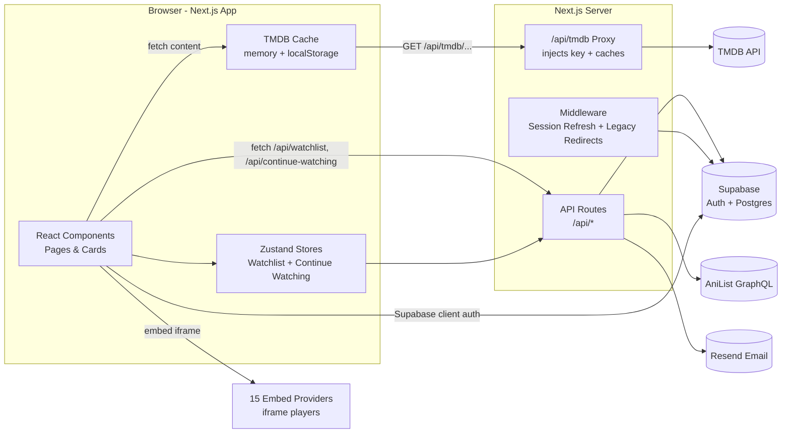

# Movime 🎬

<p align="center">
  
</p>

<p align="center">
  <strong>Click, watch, enjoy.</strong> Movime is a free streaming platform that aggregates movies, TV shows, and anime from multiple third-party sources into one seamless interface.
</p>

<p align="center">
  
  
  
  
  
  
  
</p>

---

> **Disclaimer:** Movime does not host or store any media files. All content is sourced from third-party providers and is intended for educational and informational use only.

---

## ✨ Features

- **🎥 Multi-Source Streaming** — Watch content from 14 verified embed providers with automatic source switching
- **📺 TV Shows & Seasons** — Browse episodes with season selectors and episode detail cards
- **🐱 Anime Integration** — Dedicated anime section with AniList+TMDB cross-referencing for accurate season/episode mapping
- **🏠 Anime Hero Banner** — Dedicated anime hero carousel with trailers, genre chips, and watchlist controls
- **🔍 Smart Search** — Full-text search with relevance scoring, live autocomplete, recent searches, trending suggestions, sorting (popularity/rating/year/title), and adult content filtering
- **🔖 Watch Later** — Save content with status tracking (Watching, Completed, Plan to Watch, Dropped), synced across devices via Supabase
- **⚙️ Cross-Device Settings** — Preferred source, default quality, and auto-play preferences sync across devices via Supabase (guests still use localStorage)
- **⏯️ Continue Watching** — Auto-resume playback from where you left off with progress persistence. The **PLAY** button on a detail page resumes the last episode you were on, and the watch page keeps `season`/`episode` in the URL so refreshing or sharing a link returns to the exact episode instead of restarting at S1E1
- **👤 User Accounts** — Supabase-powered authentication with profile management (avatar, bio, anime character picker)
- **📱 Progressive Web App** — Installable on mobile and desktop with offline service worker
- **🔄 Source Fallback** — Automatic source switching if a provider fails
- **🔞 Content Filtering** — Adult content and blocked content filtering for a safe experience
- **📈 Trending & Categories** — Dedicated Movies, TV Shows, and Anime pages plus Hollywood, Bollywood, Netflix Originals, and Amazon Prime sections
- **🏷️ Genre Browsing** — Genre filters built into the search page (`/search?genre=[id]&type=movie|tv`): a browse-by-genre landing when search is empty, a Movies/TV toggle, genre chips, and infinite scroll — plus quick genre chips on the Movies and TV pages
- **📧 Contact Form** — Server-side email delivery via Resend
- **🎨 Strict Monochrome UI** — Pure black canvas (`#000000`) with white as the only accent colour. No neon tints or decorative glows; red is reserved exclusively for destructive actions (sign out, clear data)
- **♿ Accessibility** — Respects `prefers-reduced-motion` (CSS + Framer Motion), global keyboard `:focus-visible` rings, and screen-reader-friendly loading indicators
- **✨ Polished Animations** — Cinematic Ken Burns zoom on the hero carousel, GPU-friendly card hovers, hover scroll arrows on content rows, and a non-flashing route loading bar
- **💀 Skeleton Loading** — Shimmer skeletons on every page (home, movies/TV/anime, details, watch, search, profile, settings, watchlist) so layout shifts are eliminated
- **🚀 Optimized Performance** — API response caching, in-flight request deduplication, and localStorage persistence for fast loads

---

## 🩹 Recent audit fixes

A full codebase pass fixed the following (each verified by typecheck, lint, unit tests, and a production build):

- **Episode tracking** — Changing episode/season on `/watch` now updates the URL (via `router.replace`, no history spam) so refreshes, shares, and the Continue Watching entry point at the episode actually being watched. Progress for the new episode starts from zero instead of inheriting the previous episode's watch time (which used to mark a fresh episode as already finished).
- **Resume everywhere** — The detail page's **PLAY** button resumes from Continue Watching (`getResumeItem`) instead of always starting at S1E1; the RESUME chip and PLAY share one lookup so they can never disagree.
- **Content filtering** — Adult-content keywords are matched on word boundaries, so legitimate titles that merely contain a keyword (`Sex Education`, `Essex Boys`, `Middlesex`, `Adulthood`) are no longer hidden. Search only lifts the metadata filter for an explicit whole-word adult query, not for words like "adulting".
- **Season lists** — Detail and watch pages build their season tabs/selectors from the show's real season list, so shows with gaps in numbering (and AniList-remapped anime) no longer offer seasons that don't exist.
- **Anime hero** — Clamps its slide index, so a shrinking content list can no longer crash or blank the banner.
- **Watchlist** — Status badges keep readable contrast, guest status changes persist to `localStorage` (matching on `content_id` as well as `id`), and the API rejects malformed `content_id` values on `PATCH`/`DELETE` with a `400` instead of a misleading `404`.
- **Hero PLAY** — Derives the media type from the item instead of assuming `movie`.
- **Navbar** — The account dropdown closes on outside click, tap, or `Escape`, and dead code was removed.
- **Mobile navbar declutter** — On phones the top bar now shows only the logo. The avatar, search icon, and sign-in button are hidden below `sm` because the bottom nav already provides You, Search, and (via the profile page) Sign Out; all of them remain on tablet/desktop, where the bottom nav doesn't exist.
- **Caching/dead code** — The legacy API-cache sweep no longer skips entries while deleting, and unused keyframes/animations and an unused export were dropped.

---

## 🎨 UI refresh

A design pass tightened the interface into a strict black-and-white system. Verified by typecheck, lint, unit tests, and a from-scratch production build.

- **Pure black canvas** — `--background` moved from a warm `#101111` to `#000000`, with card surfaces on `#0a0a0a` and a neutralized foreground/border palette. The design tokens previously declared an acid-lime accent (`--primary: #d9ff3f`) that was *also* the global focus ring, so every keyboard focus outline and accent carried a neon tint. `--primary`, `--ring`, and the white buttons are now plain white.
- **Red means destructive** — Sign Out is red, as are the destructive actions on `/settings` (**Clear Watch Later**, **Clear All Data**). The watchlist bookmark no longer turns red when saved; it uses the filled state instead.
- **Contrast fixes** — The signup error box was neutral gray while login's was red, so a failed signup rendered as helper text; both are red now. Auth inputs and settings selects were `bg-black` on black surfaces, leaving invisible wells only distinguishable by a faint border. Card status badges were white-on-translucent-white over bright posters; all variants are now white-backed with black text, matching `STATUS_INFO`.
- **Native control theming** — Added `color-scheme: dark` (plus explicit `select option` colours for WebKit) so the `<select>` popups on `/settings` no longer render as bright white sheets, and `::selection` no longer paints a blue block.
- **Accents removed** — The announcement popup's blue-tinted gradient and top glow, the loading bar's glow, the white-glow card hover shadows, and the decorative emoji in headings, genre toggles, empty states, footer, and toasts (replaced with inline SVGs or plain text).
- **Dead utility class** — `hover:shadow-3xl` on the details page was a no-op (`shadow-3xl` does not exist in Tailwind's default scale); removed.
- **Grid hover** — Card hover scale reduced from `1.05` to `1.03`, so adjacent cards no longer overlap and clip neighbours in tight grids.

---

## 🖥️ Pages & Routes

| Route | Description |
|-------|-------------|
| `/` | Homepage with 7 content sections (Trending Movies, TV Shows, Hollywood, Bollywood, Anime, Netflix, Amazon Prime) and hero carousel |
| `/movies` | Dedicated Movies page with infinite scroll |
| `/tv` | Dedicated TV Shows page with infinite scroll |
| `/anime` | Dedicated Anime page with anime hero banner and infinite scroll |
| `/details?id=&type=` | Content detail page with poster, info, watchlist management, season/episode browser, recommendations |
| `/watch?id=&type=` | Watch page with iframe-based video player and source selector sidebar |
| `/search` | Search with genre browsing (genre chips, Movies/TV toggle), sorting (relevance, popularity, rating, year, title), and infinite scroll. Legacy `/genres` and `/genre/[id]` URLs redirect here |
| `/settings` | User preferences (preferred source, default quality, auto-play, data management) |
| `/profile` | User profile management with anime character picker (requires authentication) |
| `/watchlist` | Full watchlist page with status filtering (Watching, Completed, Plan to Watch, Dropped) |
| `/contact` | Contact form with server-side email delivery (Resend) |
| `/privacy` | Privacy policy |
| `/terms` | Terms of service |
| `/about` | About Movime |

### Auth Pages

| Route | Description |
|-------|-------------|
| `/auth/login` | Sign in with email/password |
| `/auth/signup` | Create a new account |
| `/auth/forgot-password` | Request a password reset |
| `/auth/reset-password` | Set a new password |
| `/auth/callback` | OAuth callback handler for Supabase |

### API Routes

| Route | Method | Description |
|-------|--------|-------------|
| `/api/watchlist` | GET | Fetch user's watchlist items |
| `/api/watchlist` | POST | Add item to watchlist (or toggle if exists) |
| `/api/watchlist` | PATCH | Update item status |
| `/api/watchlist` | DELETE | Remove item from watchlist |
| `/api/continue-watching` | GET/POST/DELETE | Fetch, upsert, or remove continue-watching progress |
| `/api/user/profile` | GET/PUT | Fetch or update user profile |
| `/api/user/settings` | GET/PUT | Fetch or save cross-device playback settings (preferred source, quality, auto-play) |
| `/api/user/delete` | DELETE | Delete the signed-in user's account and data (rate-limited) |
| `/api/tmdb/[...slug]` | GET | Server-side TMDB proxy — injects the API key and caches responses (rate-limited) |
| `/api/anilist/character?q=` | GET | Search AniList anime characters |
| `/api/contact` | POST | Send contact form submissions via Resend |

---

## 🏗️ Tech Stack

| Technology | Purpose |
|------------|---------|
| **Next.js 15** | React framework with App Router |
| **TypeScript** | Type-safe development with strict mode |
| **Tailwind CSS** | Utility-first styling with custom animations |
| **Supabase** | Authentication, PostgreSQL database, Row Level Security |
| **Zustand** | Lightweight state management (watchlist, continue watching) |
| **Framer Motion** | Page transitions, card hover animations, hero carousels, skeleton loading |
| **TMDB API** | Movie/TV/anime metadata, images, recommendations |
| **AniList API** | Anime character search, season breakdown, episode mapping |
| **Resend** | Transactional email for the contact form |
| **Sentry** | Error monitoring (client + server) — optional, enabled via `NEXT_PUBLIC_SENTRY_DSN` |
| **Vitest** | Unit tests for lib logic, stores, and rate limiting |
| **sonner** | Toast notifications |
| **next-pwa** | Progressive Web App support |
| **Vercel Analytics** | Usage analytics and speed insights |

### Streaming Providers (iframe embed)

The platform aggregates from **14 verified embed providers** (each checked to be live): CinemaOS, VidNest, MappleTV, VidSrcRIP, VidSrcSU, VidSrcSBS, VidSrcME, VidSrcNL, VidSrcPM, VidLink, VidEasy, VidFast, VidZee, and CineSrc.

---

## 🧠 Architecture & Data Flow

Movime is a client-rendered Next.js app (App Router). All TMDB metadata requests go through a server-side proxy (`/api/tmdb`) so the API key never ships in the browser bundle, then third-party video players are embedded. User data (auth, watchlist, continue watching, profiles) is persisted through server-side API routes backed by Supabase.



### Key Data Flows

1. **Content browsing** — Pages (`/`, `/movies`, `/tv`, `/anime`, `/search`) call fetch helpers in `lib/utils.ts`, which go through the server-side `/api/tmdb` proxy (the API key is injected server-side and never ships in the client bundle) with a layered cache (in-memory + localStorage, 10-min TTL) and in-flight request deduplication. Results are filtered (adult/blocked content) before rendering.

2. **Anime mapping** — `fetchContentDetails` detects anime (genre/keyword/JP origin) and cross-references **AniList + TMDB** in `lib/animeMapper.ts` to produce accurate season/episode breakdowns, falling back to plain TMDB data when mapping fails.

3. **Watching** — The `/watch` page builds an embed URL from the selected source in `lib/sources.ts` (14 verified providers — dead providers are removed) and renders it in an iframe. Sources flagged `requiresNoSandbox` play unsandboxed (they refuse to play sandboxed); the rest are sandboxed for security. If a source fails, `handleSourceFailure` automatically falls back to the next provider. Progress is saved to the Continue Watching store.

4. **User data** — Zustand stores (`lib/store.ts`) hold watchlist and continue-watching state optimistically, then sync to Supabase via `/api/watchlist` and `/api/continue-watching`. Profiles live in `AuthProvider` and are updated via `/api/user/profile`. Guests use localStorage; signed-in users sync across devices.

5. **Auth** — `AuthProvider` restores sessions from a cached user, revalidates with Supabase, and `middleware.ts` refreshes cookies on every request while also redirecting legacy `?view=` URLs to the dedicated `/movies`, `/tv`, and `/anime` pages.

6. **Contact** — The `/contact` form POSTs to `/api/contact`, which validates and HTML-escapes the message and delivers it to `CONTACT_TO_EMAIL` via Resend.

---

## 🚀 Getting Started

### Prerequisites

- Node.js 24 (LTS) or newer and npm/bun (the test suite's jsdom 30 requires Node 22.22+ or 24.15+)
- Supabase project (for authentication and database)
- TMDB API key ([get one free](https://www.themoviedb.org/settings/api))
- Resend API key for the contact form ([get one free](https://resend.com/api-keys))

### Installation

```bash
# Clone the repository
git clone https://github.com/Manvith911/movime.git
cd movime

# Install dependencies
npm install
# or
bun install

# Set up environment variables
# Copy .env.example to .env.local and fill in your values
cp .env.example .env.local
```

### Environment Variables

Create a `.env.local` file with the following (see `.env.example` for details):

```env
# Supabase (required for authentication, watchlist, and continue watching)
NEXT_PUBLIC_SUPABASE_URL=https://your-project.supabase.co
NEXT_PUBLIC_SUPABASE_ANON_KEY=your_supabase_anon_key

# Secret key for admin operations (account deletion). MUST stay server-only —
# never prefix with NEXT_PUBLIC_.
SUPABASE_SERVICE_ROLE_KEY=your_service_role_key

# TMDB (required for movie/TV/anime data). All TMDB requests are proxied
# server-side through /api/tmdb, so the key never ships in the client bundle.
TMDB_API_KEY=your_tmdb_key
# Legacy fallback (deprecated): only used when TMDB_API_KEY is unset. Because
# it starts with NEXT_PUBLIC_ it ships in the client bundle — remove it once
# TMDB_API_KEY is set.
# NEXT_PUBLIC_TMDB_API_KEY=your_tmdb_key

# Resend (required for the contact form)
RESEND_API_KEY=re_your_resend_key
CONTACT_TO_EMAIL=you@example.com
RESEND_EMAIL_FROM=Movime <onboarding@resend.dev>

# Optional: image proxy for privacy/caching of TMDB images
NEXT_PUBLIC_IMAGE_PROXY=https://images.weserv.nl/?url=

# Optional: global (cross-instance) API rate limiting via Upstash Redis.
# Without these, rate limits are enforced per serverless instance.
# UPSTASH_REDIS_REST_URL=https://your-db.upstash.io
# UPSTASH_REDIS_REST_TOKEN=your-token

# Optional: Sentry error monitoring (skip to disable)
NEXT_PUBLIC_SENTRY_DSN=https://example@sentry.example/1
```

### Supabase Setup

1. Create a Supabase project at [supabase.com](https://supabase.com)
2. Run the SQL schema from `lib/supabase/schema.sql` (profiles, watch_later) in the Supabase SQL Editor
3. Run `lib/supabase/continue_watching.sql` for the continue-watching table
4. Run `lib/supabase/user_settings.sql` for cross-device settings sync
5. Enable email/password auth in Authentication → Providers
6. Copy your project URL and anon key to `.env.local`

### Development

```bash
# Start dev server
npm run dev
```

### Testing

```bash
# Typecheck (strict TypeScript)
npm run typecheck

# Lint
npm run lint

# Run the unit test suite once
npm test

# Run tests in watch mode
npm run test:watch

# E2E smoke test (mocked TMDB fixtures; requires the server running)
npm run build
npm run test:e2e
```

Every push and pull request is also checked automatically by the GitHub Actions workflow in `.github/workflows/ci.yml` — typecheck, lint, unit tests, production build, and the e2e smoke test.

### Build for Production

```bash
npm run build
npm start
```

---

## 🏗️ Project Structure

```
movime/
├── .github/
│   └── workflows/
│       └── ci.yml       # GitHub Actions: typecheck, lint, tests, build, e2e
├── app/
│   ├── about/           # About page
│   ├── anime/           # Anime page with hero banner
│   ├── api/
│   │   ├── anilist/     # AniList character search API
│   │   ├── contact/     # Contact form email API (Resend, rate-limited)
│   │   ├── continue-watching/  # Continue watching CRUD API (rate-limited)
│   │   ├── tmdb/        # Server-side TMDB proxy (injects key, caches, rate-limited)
│   │   ├── user/
│   │   │   ├── delete/  # Account deletion API (rate-limited)
│   │   │   ├── profile/ # User profile API (rate-limited)
│   │   │   └── settings/ # Cross-device playback settings API (rate-limited)
│   │   └── watchlist/   # Watchlist CRUD API (rate-limited)
│   ├── auth/            # Login, signup, forgot/reset password, callback
│   ├── contact/         # Contact page
│   ├── details/         # Content detail page (DetailsPageContent.tsx)
│   ├── movies/          # Movies page with infinite scroll
│   ├── privacy/         # Privacy policy
│   ├── profile/         # User profile page with anime character picker
│   ├── search/          # Search + genre browsing page (chips, Movies/TV toggle)
│   ├── settings/        # User settings page
│   ├── terms/           # Terms of service
│   ├── tv/              # TV Shows page with infinite scroll
│   ├── watch/           # Watch/player page (WatchPageContent.tsx)
│   ├── watchlist/       # Full watchlist management page
│   ├── global-error.tsx # Global error boundary
│   ├── globals.css      # Global styles & animations
│   ├── layout.tsx       # Root layout (AuthProvider, PWA, fonts, analytics)
│   ├── page.tsx         # Homepage
│   ├── robots.ts        # Robots.txt
│   └── sitemap.ts       # Sitemap.xml
│
│   # Every page route also has a layout.tsx with per-route SEO metadata
│   # (e.g. app/movies/layout.tsx) — those folders are omitted above for brevity.
├── components/
│   ├── AniListCharacterPicker.tsx  # Modal for picking anime character avatar
│   ├── AnimeHero.tsx              # Anime carousel hero banner
│   ├── AnnouncementPopup.tsx      # Announcement banner
│   ├── AuthProvider.tsx           # Supabase auth context provider
│   ├── Avatar.tsx                 # User avatar with fallback initials
│   ├── BottomNav.tsx              # Mobile bottom navigation
│   ├── BrowseContent.tsx          # Shared grid page (movies/tv/anime)
│   ├── ContentCard.tsx            # Poster card with watchlist controls
│   ├── ContentSection.tsx         # Horizontal scrollable content row
│   ├── Footer.tsx                 # App footer with disclaimer
│   ├── HeroSection.tsx            # Hero carousel (featured movies)
│   ├── LoadingBar.tsx             # Route loading indicator (grace delay, no flash)
│   ├── MotionProvider.tsx         # Framer Motion config (reducedMotion="user")
│   ├── Navbar.tsx                 # Navigation bar with user menu
│   ├── ProxyImage.tsx             # Image proxy wrapper (privacy/caching)
│   ├── SearchAutocomplete.tsx     # Live search suggestions
│   ├── ShareButton.tsx            # Share content
│   ├── SkeletonCard.tsx           # Skeleton section/grid primitives
│   ├── SkeletonDetails.tsx        # Details page skeleton
│   ├── SkeletonHero.tsx           # Hero carousel skeleton
│   ├── SkeletonPageLayout.tsx     # Shared page shell skeleton
│   ├── SkeletonProfile.tsx        # Profile page skeleton
│   ├── SkeletonSearch.tsx         # Search page skeleton
│   ├── SkeletonSettings.tsx       # Settings page skeleton
│   ├── SkeletonWatch.tsx          # Watch page skeleton
│   ├── SkeletonWatchlist.tsx      # Watchlist page skeleton
│   └── Toaster.tsx                # Toast notifications (sonner)
├── lib/
│   ├── __tests__/       # Unit tests (Vitest)
│   ├── animeMapper.ts   # AniList + TMDB anime season mapping
│   ├── contentMeta.ts   # Per-page SEO metadata helpers
│   ├── rateLimit.ts     # API rate limiting
│   ├── requestGuard.ts  # Same-origin & CSRF request guards
│   ├── resend.ts        # Lazy Resend client
│   ├── routes.ts        # View -> route mapping
│   ├── settings.ts      # Playback settings (localStorage + server sync)
│   ├── sources.ts       # 14 available embed streaming sources
│   ├── store.ts         # Zustand stores (watchlist, continue watching)
│   ├── supabase/
│   │   ├── client.ts    # Supabase browser client
│   │   ├── server.ts    # Supabase server client (cookies)
│   │   ├── middleware.ts # Supabase session refresh middleware
│   │   ├── schema.sql   # Database schema (profiles, watch_later)
│   │   ├── continue_watching.sql  # Continue watching table schema
│   │   └── user_settings.sql      # Playback settings table schema
│   ├── types.ts         # TypeScript interfaces
│   └── utils.ts         # API functions, caching, content filtering
├── public/              # Static assets, PWA manifest, icons
├── scripts/
│   ├── generate-icons.js # PWA icon generation
│   └── e2e-fixtures.mjs  # E2E smoke test with mocked TMDB fixtures
├── middleware.ts        # Legacy redirects + Supabase session refresh
├── instrumentation.ts       # Sentry server instrumentation
├── instrumentation-client.ts # Sentry client instrumentation
├── next.config.js       # Next.js + Sentry + PWA config
├── package.json
├── sentry.edge.config.ts    # Sentry edge runtime config
├── sentry.server.config.ts  # Sentry server config
├── tailwind.config.js   # Tailwind theme
├── tsconfig.json        # TypeScript config
└── vitest.config.ts     # Vitest test config
```

---

## 🎮 Usage

### Watching Content

1. Browse content on the homepage, or use the Movies / TV Shows / Anime pages
2. Click any card to go to the detail page
3. Click **Play** or go directly via `/watch?id=123&type=movie` — for a TV show you've already started, **Play** resumes from your last episode
4. If a source fails, manually switch sources from the source sidebar
5. For TV shows, select season and episode before watching — the URL updates to `&season=[s]&episode=[e]` as you switch, so the address bar always points at what's playing

### Watchlist Management

1. On any detail page, click **+ MY LIST** to add content
2. Choose a status: Watching, Completed, Plan to Watch, or Dropped
3. Click the button again to update status or remove from list
4. View and filter your full watchlist at `/watchlist`

### Search Tips

- Type any movie/TV show/anime name
- Search results are relevance-sorted
- Use the sort menu to sort by popularity, rating, year, or title
- Click a genre chip (or a section on the empty search page's browse-by-genre landing) to browse everything in that genre, with a Movies/TV toggle and infinite scroll
- Content is filtered for appropriate audiences by default

### Anime Viewing

- Navigate to the **Anime** page (or the Anime section on the homepage)
- Click any anime to see details with enhanced season/episode breakdown
- Anime episode data is cross-referenced between TMDB and AniList for accurate mapping

---

## 🔧 Configuration

### Adding Streaming Sources

Edit `lib/sources.ts` to add or remove embed providers:

```typescript
{
  id: 'mysource',
  name: 'My Source',
  isFrench: false,
  requiresNoSandbox: true, // set false for secure mode filtering
  playerType: 'embed',
  urls: {
    movie: 'https://example.com/embed/movie/{id}',
    tv: 'https://example.com/embed/tv/{id}/{season}/{episode}'
  }
}
```

The `{id}`, `{season}`, and `{episode}` placeholders are automatically replaced. `requiresNoSandbox: true` sources play unsandboxed (they refuse to play when sandboxed), and `playerType` is `'embed'` for iframe embeds or `'native'` for native players.

### Image Proxy

Images from TMDB are proxied through `https://images.weserv.nl/?url=` by default to improve privacy and caching. Configure via `NEXT_PUBLIC_IMAGE_PROXY`. AniList images bypass the proxy.

---

## 🤝 Contributing

Feedback and feature requests are welcome — use the contact form at `/contact` or reach out to the developer on [GitHub](https://github.com/Manvith911).

See [CONTRIBUTING.md](CONTRIBUTING.md) for the full contribution guide — including how to report bugs, request features, set up the project locally, code style, and the pull request process.

---

## 📄 License

This project is for educational purposes only. See `LICENSE` for more information.

---

## 🙏 Acknowledgments

- [TMDB](https://www.themoviedb.org/) for movie/TV metadata
- [AniList](https://anilist.co/) for anime data and character search
- [Resend](https://resend.com/) for contact form email delivery
- [Supabase](https://supabase.com/) for authentication and database
- [Vercel](https://vercel.com/) for hosting and analytics
- All the third-party embed providers for streaming infrastructure
